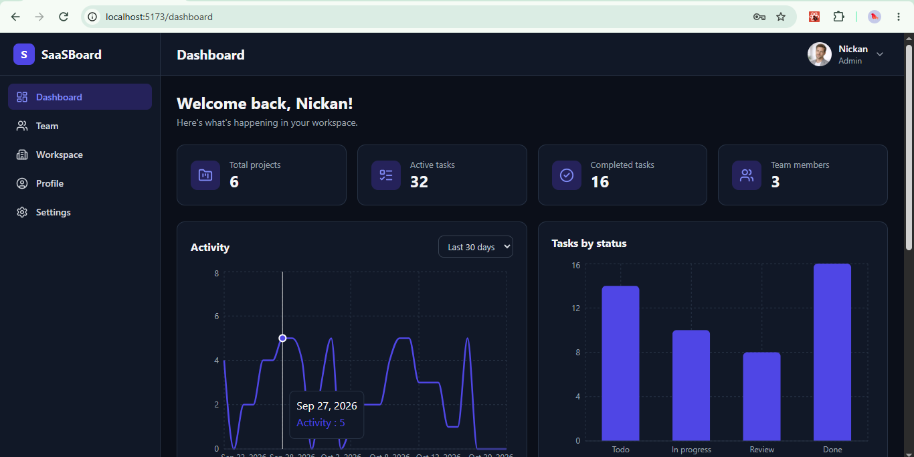
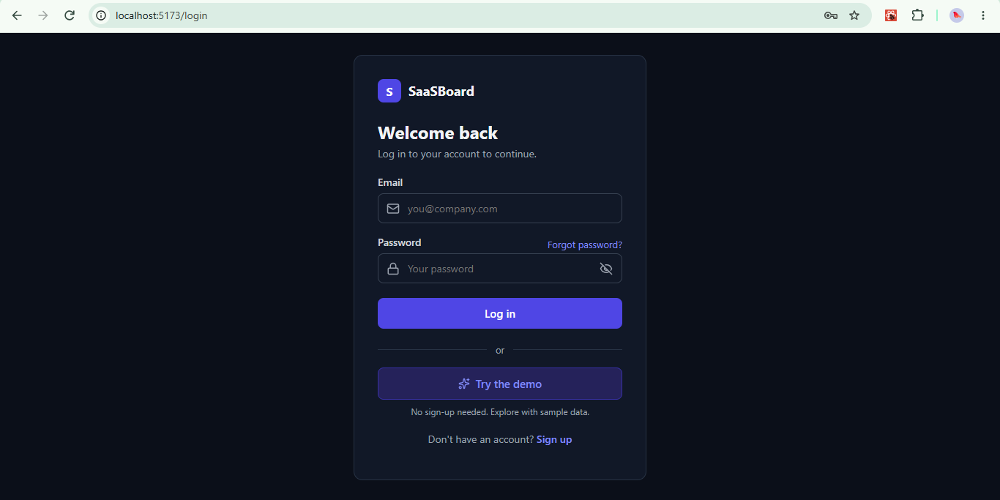
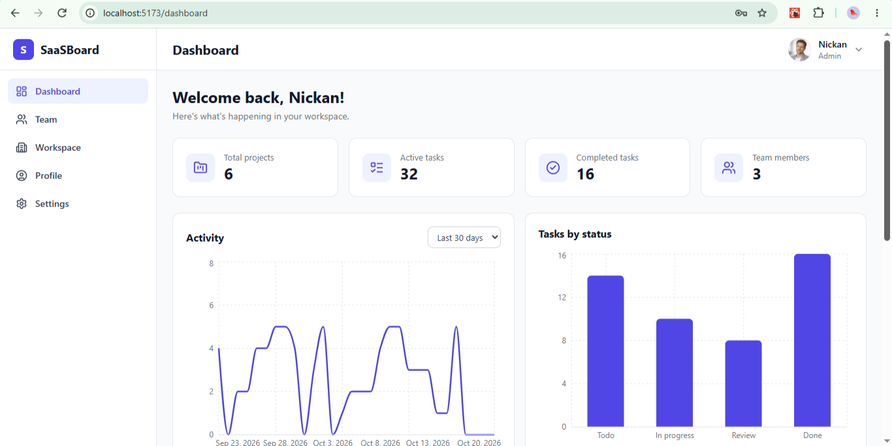
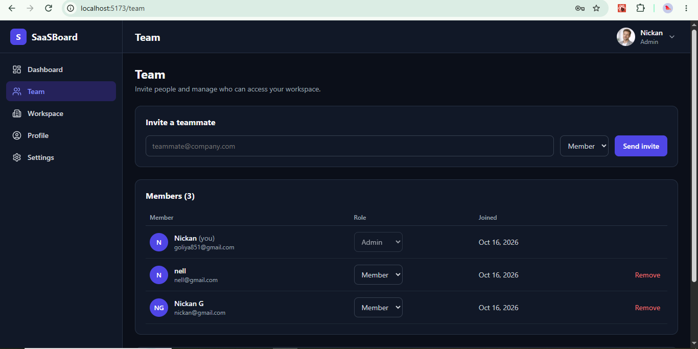
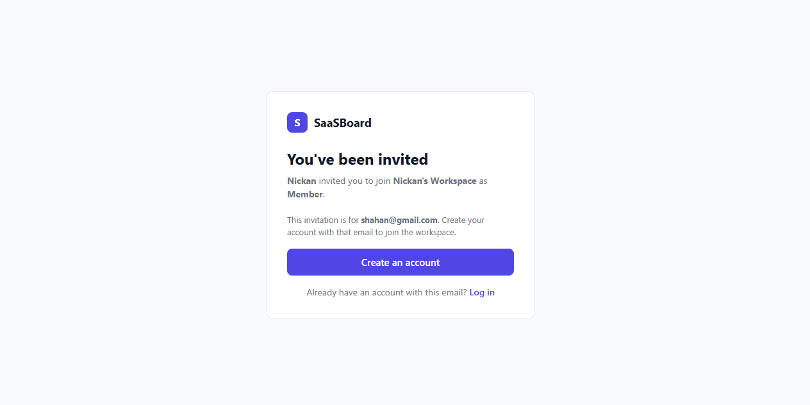
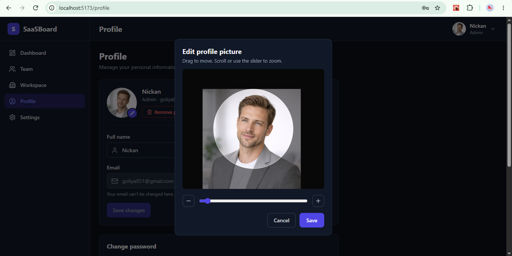

# SaaSBoard: the secure foundation every SaaS needs

**A multi-tenant team workspace and analytics dashboard, built end to end.**

[Live demo](https://saasboard-app.vercel.app) · [Source code](https://github.com/gulistankh/saasboard) · [Video walkthrough](https://youtu.be/8YKRoAE_wNg)

## Watch it in action

▶️ **[Watch the 100-second walkthrough](https://youtu.be/8YKRoAE_wNg)**

## The short version

Before a SaaS product can do anything unique, it needs the same boring foundation: accounts, secure login, teams, permissions, and a place to see data. Getting this wrong is expensive, because a security mistake in the base can sink a young company. I built that foundation as a complete, working product so founders can see exactly what they would get.

## The problem

Early-stage founders usually face one of two bad options. They can spend weeks and a large budget building authentication and team features that every competitor also has, or they can stitch together no-code tools that break down when the product needs custom logic, strict permissions, or real data ownership.

Both options delay the thing that matters most: shipping the feature customers actually pay for.

## What I built

- **Secure accounts:** signup, email verification, login, and password reset
- **Teams and roles:** Admin and Member roles, email invitations, and team management
- **Workspace isolation:** every company's data is fully separated from every other company's
- **A live dashboard:** stats, charts and a project table, all from a real PostgreSQL database
- **Details that make it feel finished:** profile pictures with crop and zoom, dark and light themes, and notification settings
- **A one-click demo:** visitors explore with sample data and no sign-up

## Key decisions

**Permissions are enforced on the server, not just in the interface.** Hiding a button is not security. Every request is checked against the user's current role, so a demoted admin loses access immediately.

**Passwords and links are stored safely.** Passwords use Argon2id, a current industry recommendation. Reset and invite links are single-use, expire, and are stored only as hashes, so a database leak can't be turned into working links.

**Sessions are short-lived and rotate.** Access lasts 15 minutes, and the long-lived session token sits in a protected cookie that scripts can't read and is replaced on every use.

**Teams can't lock themselves out.** The last admin of a workspace can't be removed or demoted, and only the owner can delete a workspace.

**Login and password reset reveal nothing.** The app gives the same answer whether or not an email exists, so attackers can't use it to discover which accounts are registered.

## Challenges worth mentioning

**Invited people ended up as admins of a brand-new workspace.** While testing, I found that someone invited to join a team could sign up through the normal form and get a separate workspace of their own. I redesigned signup so an invitation link places the person directly in the inviting workspace with the right role.

**Free hosting without breaking secure logins.** The backend and frontend live on different addresses, and browsers block cookies between different sites. Instead of weakening the cookie settings, I made the frontend forward API requests so the browser sees one site and the secure cookie works.

**A public demo that can't be abused.** The demo creates a private workspace per visitor and deletes it after 24 hours. Actions that could be abused, like sending invitations to strangers or uploading files, are disabled for demo users, and creation is rate-limited.

## Polish that clients notice

Profile pictures can be cropped and zoomed before saving, so users get exactly the framing they want, whatever the original file size.

## Results

This is a self-initiated project, so there are no client numbers to quote. What I can say honestly:

- It's fully deployed and live, running on free-tier services.
- It covers the whole foundation of a SaaS product and runs against a real database.
- Every account, role and permission flow works end to end, including the edge cases.

## Built with

React, Vite, Node.js, Express, PostgreSQL, Zod, JWT, Argon2id

## What this means for your product

You wouldn't pay for this foundation to be reinvented. I'd adapt it to your roles, your branding and your data, and spend your budget on the feature that makes your product different.

**Have an idea for a SaaS?** [Let's talk about the first version.](https://gulistankh.github.io/portfolio/#contact)